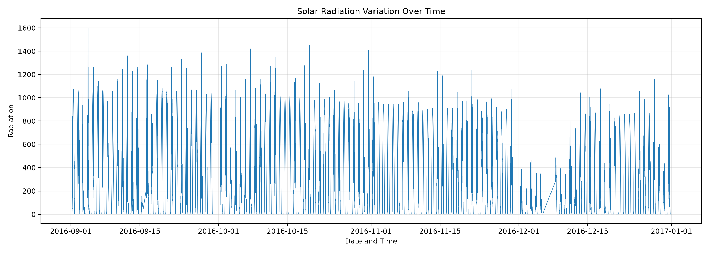
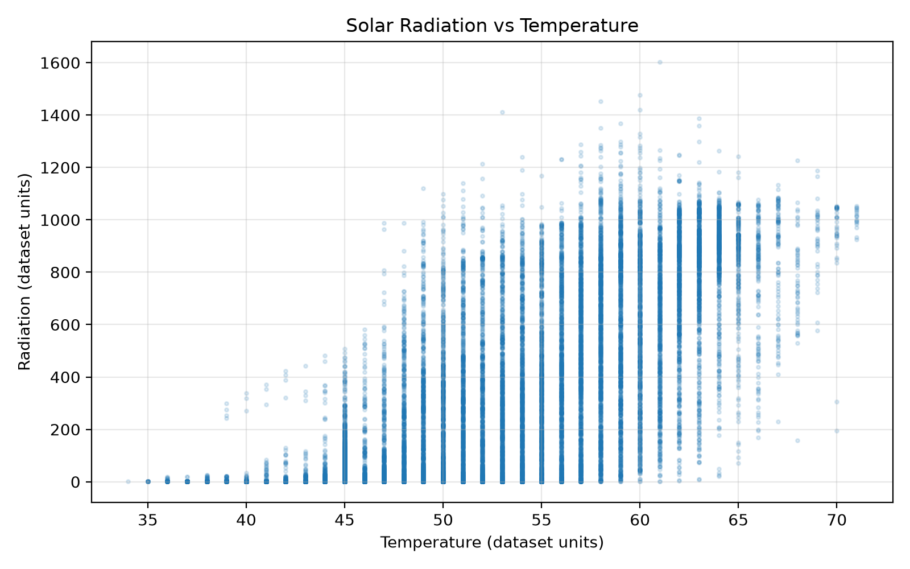
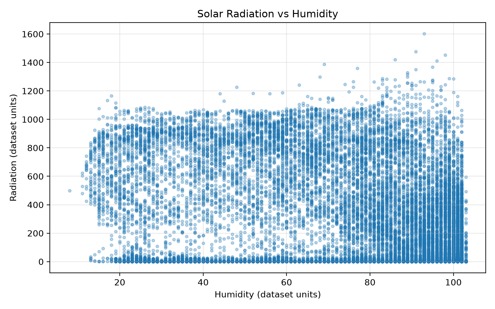
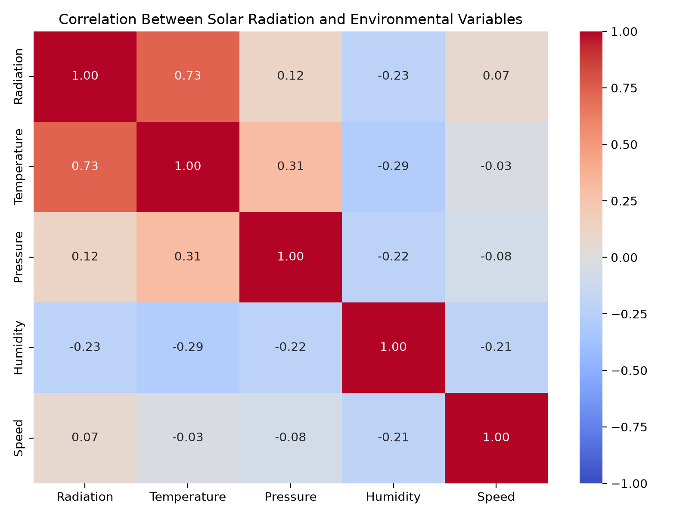
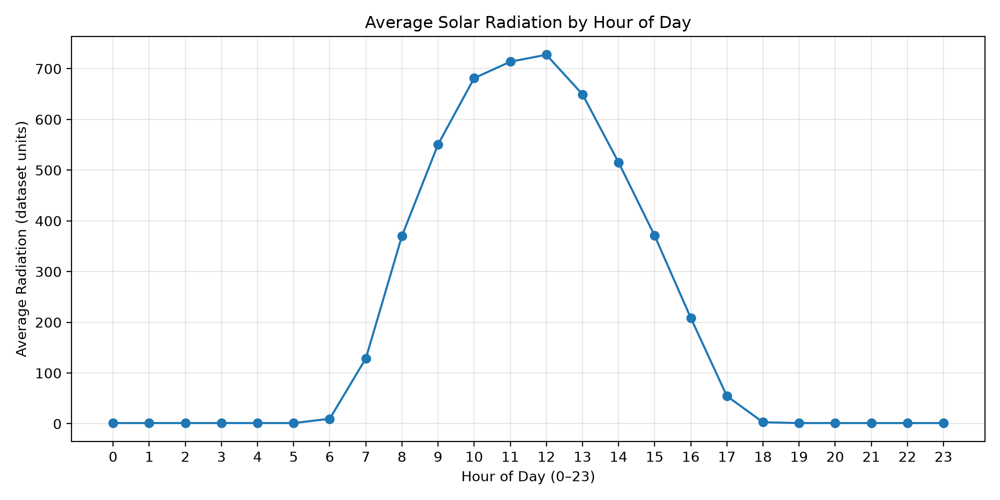

# STAC WARS — PS2: Solar Radiation Analysis and Prediction

## 1. Introduction

Solar radiation is an important source of energy. Analysing its variation over time and its relationship with environmental parameters can help us understand patterns in the recorded observations.

The objective of this project is to analyse the superior Voyage-123 solar observation dataset using Python, Pandas, NumPy and data visualisation libraries. The analysis investigates relationships between solar radiation and environmental parameters, daily radiation statistics, potential outliers and the time of peak radiation.

## 2. Dataset Description

The dataset used for this analysis is `SolarPrediction.csv`.

| Property | Description |
|---|---|
| Number of observations | 32,686 |
| Original columns | 11 |
| Observation period | September 1–December 31, 2016 |

The dataset contains the following variables:

- **Date and time:** `Data`, `Time` and `UNIXTime`
- **Solar radiation:** `Radiation`
- **Environmental parameters:** `Temperature`, `Pressure`, `Humidity`, `WindDirection(Degrees)` and `Speed`
- **Sunrise and sunset:** `TimeSunRise` and `TimeSunSet`

### Data preprocessing

The date and time fields were combined to create a datetime column using Pandas. The resulting timestamps were checked for invalid values and sorted chronologically.

Additional columns were created to extract the calendar date, hour of the day, and sunrise and sunset times for further analysis.

The initial dataset contained no missing values according to the column-wise check. However, four calendar dates were absent from the observations: September 30, November 30, December 6 and December 7, 2016. These dates were not filled with artificial zero-radiation observations because no measurements were available for them.

## 3. Data Visualisation

### 3.1 Solar Radiation Variation Over Time

The time-series plot shows repeated daily rises and falls in solar radiation. Radiation frequently approaches zero during nighttime and increases during daylight hours.

The heights of the daily peaks vary throughout the observation period. Some observations reach very high values, while other periods have lower peaks. These patterns demonstrate that recorded solar radiation varies both within individual days and across the study period.

### 3.2 Solar Radiation versus Temperature

The scatter plot shows a generally positive association between temperature and solar radiation. Higher temperatures tend to be associated with higher radiation readings, although substantial variation remains at similar temperatures.

The Pearson correlation coefficient between temperature and radiation was approximately **+0.735**, indicating a fairly strong positive linear association in this dataset.

### 3.3 Solar Radiation versus Humidity

The scatter plot shows considerable variation in radiation across humidity levels. The Pearson correlation coefficient between humidity and radiation was approximately **−0.226**, indicating a weak negative linear association.

This result suggests that humidity alone is not strongly linearly associated with radiation in the observed data.

### 3.4 Correlation Heatmap

The correlation heatmap provides a visual comparison of the linear relationships between the numerical environmental variables and solar radiation.

Temperature has the strongest positive Pearson correlation with radiation among the environmental parameters examined. Pressure and wind speed have weak positive correlations, while humidity and wind direction have negative correlations.

Wind direction is an angular variable, so its ordinary Pearson correlation should be interpreted cautiously.

### 3.5 Average Solar Radiation by Hour

The hourly analysis reveals a clear daily pattern. Average radiation increases during the morning, reaches its highest hourly average at noon and then decreases throughout the afternoon.

The highest average radiation occurred at **12:00**, with an hourly average of approximately **727.47 units**. Average radiation approached zero during the evening and nighttime hours.

## 4. Inferences from the Visualisations

### 4.1 Time of Highest Radiation

The hourly analysis identified 12:00 as the hour with the highest average radiation, approximately 727.47 dataset units. Radiation increased during the morning and declined during the afternoon, consistent with the daily variation in available sunlight.

### 4.2 Strongest Environmental Relationship

Temperature had the strongest Pearson linear correlation with radiation among the five environmental parameters examined. Its correlation coefficient was approximately +0.735.

The other observed correlations were:

| Environmental parameter | Pearson correlation with radiation |
|---|---:|
| Temperature | +0.735 |
| Pressure | +0.119 |
| Speed | +0.074 |
| Humidity | −0.226 |
| Wind direction | −0.230 |

Temperature therefore showed the strongest linear association with radiation in this dataset. These associations do not establish that temperature or any other parameter causes changes in radiation.

### 4.3 Temperature and Humidity Patterns

Higher temperatures tended to occur alongside higher radiation readings, whereas humidity exhibited a weaker negative linear association with radiation.

The broad spread of points in both scatter plots shows that temperature and humidity do not fully explain the variation in individual radiation readings. Time of day and other environmental conditions may also be relevant.

### 4.4 Unusual Observations and Potential Outliers

The highest recorded radiation value was 1601.26 on September 4, 2016, at 12:15:04. Several other high readings occurred during late morning or around noon.

The global interquartile range (IQR) method flagged 1,965 observations as potential outliers. An hour-specific application flagged 2,229 observations, while a month-hour-specific application flagged 610 observations.

The change in counts demonstrates that the identification of potential outliers depends on how the observations are grouped. Solar radiation varies with the time of day and the observation period, so a high value is not automatically a measurement error. These flagged observations are candidates for further investigation, not confirmed errors.

## 5. Solar Day Analysis

### 5.1 Daily Maximum and Mean Radiation

The observations were grouped by calendar date using Pandas. The maximum radiation and mean radiation were calculated for each date.

The daily maximum describes the highest individual reading recorded on a particular day, while the daily mean summarises all available radiation readings for that day.

### 5.2 Highest Recorded Radiation

The highest recorded radiation in the dataset was **1601.26**, observed on September 4, 2016, at 12:15:04.

| Measurement | Recorded value |
|---|---:|
| Date | September 4, 2016 |
| Time | 12:15:04 |
| Maximum radiation | 1601.26 |
| Temperature | 61 |
| Humidity | 93 |
| Wind speed | 9.00 |
| Sunrise | 06:08:00 |
| Sunset | 18:35:00 |
| Elapsed time from sunrise to peak | 6 hours, 7 minutes, 4 seconds |

The peak occurred between the recorded sunrise and sunset times. The environmental values above describe the conditions recorded at the peak observation.

The measurement units should be confirmed from the dataset documentation before being stated in the final report.

### 5.3 Top Five Days by Average Radiation

The five dates with the highest daily mean radiation were:

| Rank | Date | Daily mean radiation | Daily maximum radiation |
|---|---|---:|---:|
| 1 | September 19, 2016 | 335.504400 | 1085.75 |
| 2 | September 2, 2016 | 333.471219 | 1062.01 |
| 3 | September 22, 2016 | 325.515880 | 1053.17 |
| 4 | September 25, 2016 | 319.921514 | 1075.29 |
| 5 | September 28, 2016 | 312.400390 | 1029.30 |

September 19 had the highest daily mean radiation among the dates analysed. This differs from September 4, which had the highest single radiation reading. The daily mean accounts for all recorded radiation measurements on a given date rather than just one peak reading.

### Complete Daily Statistics

The complete day-wise radiation summary is provided in
[daily_radiation_summary.csv](daily_radiation_summary.csv).

The file contains the daily maximum and mean radiation for
all 118 dates with available observations.

## 6. Limitations

The analysis has several limitations:

1. Four calendar dates have no observations, so comparisons across days should account for incomplete time coverage.
2. Correlation measures linear association and does not establish causation.
3. Global and grouped IQR thresholds identify potential outliers but do not determine whether readings are erroneous.
4. The environmental units and measurement context should be confirmed from the original dataset documentation.
5. The hourly averages summarise observations from the available dates and may be influenced by missing dates or uneven observation counts.

## 7. Conclusion

The analysis identified a strong positive linear association between temperature and solar radiation, while humidity, pressure and wind speed showed weaker correlations. The highest hourly average radiation occurred at 12:00, at approximately 727.47 dataset units.

The highest individual radiation reading was 1601.26, recorded on September 4, 2016, at 12:15:04. The five highest daily means all occurred in September. The outlier analysis also showed that the number of flagged readings depends on how the data is grouped.

Overall, the visualisations and daily summaries reveal a clear daily radiation pattern and substantial variation between observations. These results provide a quantitative overview of the dataset while highlighting the importance of considering missing dates, measurement context and the limitations of correlation-based analysis.